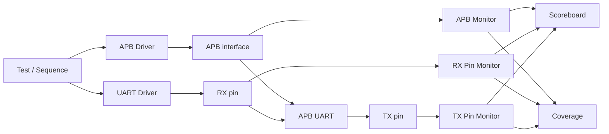

# APB UART UVM 功能验证

[](https://github.com/jiangzheyi1234-star/apb-uart-uvm/actions/workflows/verification.yml)

[English](README.en.md) · [在线证据](https://jiangzheyi1234-star.github.io/apb-uart-uvm/) · [五轮优化记录](docs/optimization_rounds.md)

基于 PULP Platform 开源 APB UART，自建双 Agent 验证环境、独立参考模型、功能覆盖率和自动回归，并维护单独的 RTL 缺陷修复版。

**已执行真实 UVM 仿真：核心回归 45/45、RAL 专项 3/3 通过。** 实测工具为 Verilator 5.054、Accellera UVM 2020.3.1、Ubuntu 24.04 WSL2。Questa/VCS 入口已提供；没有把它们列为已运行工具。

本项目可直接演示的特色：

- **DLAB 感知的 RAL**：普通/分频双 map，frontdoor 锁住多拍 APB 切换并恢复真实 LCR；显式 predictor 按观测到的 bank 更新 mirror。覆盖复位、随机读写、并发访问与地址镜像，见 [RAL 实现](tb/ral/README.md)。
- **实测检查器负向对照**：4 类运行时故障全部触发预期 checker，6 次注入前/后干净控制均通过；不修改第三方 RTL，也不把超时或崩溃算作检出。
- **可审阅的缺陷闭环**：原版严格需求失败与修复版通过并列保存；独立双向引脚比对、周期级 FIFO 模型、coverage.dat 和源码摘要均可核对。
- **真实开源工具 CI**：固定官方工具与 Action 提交，运行核心回归、故障检出和 RAL，保存原始产物。徽章连接实际 workflow 状态。

[开源项目对标](docs/industry_benchmark.md) · [广州岗位与面试演示](docs/guangzhou_interview.md) · [GitHub Actions](https://github.com/jiangzheyi1234-star/apb-uart-uvm/actions)

| 最终修复版指标 | 实测值 |
| --- | ---: |
| 核心测试场景 × seed | 15 × 3（1、2、3） |
| 核心 UVM 回归 | 45/45 PASS，ERROR/FATAL 均为 0 |
| RAL 追加专项 | 3/3 PASS，4 个存储寄存器、每 seed 12 轮随机访问 |
| 检查器受控故障 | 4/4 检出，6/6 干净对照通过 |
| 核心 Scoreboard TX / RX 比对 | 1,039 / 1,216 帧，合计 2,255 帧 |
| 核心功能 bins 未加权命中率 | 272/277，98.19% |
| 帧格式 × 波特周期交叉 | 96/96，100% |
| RTL LCOV 行命中率 | 453/474，95.57% |
| RTL LCOV 分支命中率 | 1,670/2,120，78.77% |

核心与 RAL 合计 **16 类场景、48/48 通过、2,261 帧双向数据比对**（核心 45 次/2,255 帧 + RAL 3 次/6 帧）；RAL 专项累计 168 次写和 291 次 mirror 读。另有 10 次检查器实验：4 次预期的原始 FAIL、6 次干净对照 PASS，不计入 48 次分母。覆盖率指标来自核心 45 次。

[可复核的结果报告](https://jiangzheyi1234-star.github.io/apb-uart-uvm/release/) · [RAL 与检查器证据](https://jiangzheyi1234-star.github.io/apb-uart-uvm/features/) · [验收记录](docs/validation.md) · [覆盖缺口分析](docs/coverage_analysis.md) · [面试讲解](docs/interview_guide.md)

功能 bin 比例与代码行覆盖率分别计量。5 个未命中 bin 是修复版不应产生的无效中断编码诊断项，未通过修改覆盖组或排除这些项来提高数字。代码覆盖率按 Verilator 的原生计数器导出 LCOV，工具与统计口径均在证据中保留。

## 来源与实现边界

实际 RTL 来源为 [pulp-platform/apb_uart_sv](https://github.com/pulp-platform/apb_uart_sv)，固定提交 [dfad6e04d19cc9481d3cd2750b45b970dc61271b](https://github.com/pulp-platform/apb_uart_sv/commit/dfad6e04d19cc9481d3cd2750b45b970dc61271b)。原方案中的 `pulp-platform/uart` 地址返回 404。

- `rtl/` 是未修改的上游源码。5 个 RTL 文件及许可证等 8 个文件均通过 Git blob 校验。
- `rtl_fixed/` 是本项目的本地修复版，修复逐帧校验/停止位错误标记、RX 中断接线与中断确认；没有声称修改已被上游接收。
- 上游两个顶层文件内容相同、均声明 `apb_uart_sv`，只导入并编译其中一个，避免重复模块。
- 设计沿用 Solderpad Hardware License 0.51；原始许可、版权和来源见 [third_party](third_party/apb_uart_sv/LICENSE) 与 [manifest](third_party/apb_uart_sv/manifest.json)。
- 验证环境、测试、参考模型、回归、覆盖分析和证据工具是本项目新增实现。

[寄存器表](docs/registers.md) · [原版缺陷](docs/rtl_findings.md) · [修复行为约定](docs/rtl_fixes.md) · [验证计划](docs/verification_plan.md)

这是一套明确范围内的 UART 验证项目：只支持该实现的 5～8 位、偶校验开关、TX 1/2 停止位与字节地址寄存器模型。没有宣称完整 16550 兼容性、完整四态签核、任意波特率偏差或配置热切换已验证。

## 项目结构

```text
rtl/                    未修改的上游 RTL
rtl_fixed/              独立修复版本，每次编译只选一套
tb/
  apb_agent/            APB item / sequencer / driver / monitor
  uart_agent/           RX 驱动与 TX/RX 独立引脚监视器
  scoreboard/           双向数据预测、周期级 TX 容量模型、复位清理
  coverage/             总线、格式、分频、错误、复位、中断覆盖
  ral/                  DLAB 感知双 map、APB adapter、互斥 frontdoor、显式 predictor
  env/ seq/ test/       环境连接、可复用访问序列、15 项核心场景 + RAL 专项
sim/                    原版/修复版文件列表、Makefile
py/                     回归、原生覆盖分析、证据、验收、打包
scripts/                固定工具版本安装与完整回归入口
tests/                  Python 工具的解析、进程、失败路径测试
docs/                   计划、源码发现、实测报告、讲解与证据
third_party/            上游许可与来源校验
```

## 验证架构



TX 期望来自 Monitor 观察到的 THR 访问，RX 期望来自独立引脚解码。Scoreboard 不读取 DUT 内部 FIFO/状态机。TX 模型按配置帧周期预测 16 个 FIFO 槽位和发送移位器，满时同周期出队仍拒绝新写；RX 模型保留满 FIFO 外等待的第 17 帧。复位清空预测并通过 epoch 丢弃旧残帧。

APB 在下降沿驱动、上升沿采样，包含 Setup/Access 稳定性断言。数据位按配置位周期的中点采样，支持独立识别错误校验和低停止位。

## 已运行场景

| 测试 | 检查内容 |
| --- | --- |
| `uart_smoke_test` | 双向收发、5～8 位、校验开关、1/2 停止位、数据模式与 DLAB 读回 |
| `uart_fifo_boundary_test` | TX 17 帧短突发、RX 16 字节满/空、回绕、FIFO 清除 |
| `uart_error_test` | 错误帧注入；按所选版本检查已记录行为或正确 PE/FE |
| `uart_reset_test` | 双向帧中复位、清理残帧、重新配置与恢复 |
| `uart_tx_overflow_test` | 21 次短突发写，17 帧接受、4 帧丢弃与恢复 |
| `uart_rx_retention_test` | RX 第 17 帧等待并保持顺序，排空后继续收发 |
| `uart_empty_read_test` | 空读不下溢、不破坏后续数据 |
| `uart_address_mirror_test` | 高位地址镜像、两套 DLAB bank、只读/未实现写忽略 |
| `uart_parity_requirement_test` | 错误校验必须置 PE |
| `uart_framing_requirement_test` | 低停止位必须置 FE |
| `uart_error_association_test` | 正常/错误/正常字节与错误标记逐项关联 |
| `uart_irq_test` | 原版缺陷特征；修复版四档阈值、优先级、确认、重触发 |
| `uart_irq_requirement_test` | 始终强制正确中断需求 |
| `uart_random_stress_test` | 16 批随机全双工流，每 seed 每方向超过 100 字节，保存刺激摘要 |
| `uart_baud_sweep_test` | 48 组格式与分频组合，96 个双向交叉 bin |
| `uart_ral_test` | 四寄存器随机读写、DLAB 恢复、并发 frontdoor、复位与被动预测 |

原版严格需求测试产生的 FAIL 保留原始状态，用于证明检查器能发现缺陷；不把缺陷特征测试的通过当作设计功能正确。

## 在本机复跑

Windows 已使用现有 WSL Ubuntu 完成运行。PowerShell 进入项目目录后：

```powershell
python py/verify_rtl.py
python -m unittest discover -s tests -v
wsl -d Ubuntu --cd 'C:\研究生\ic项目' -- bash scripts/run_full_regression.sh --out results/my_fixed_run
```

WSL/Linux 内从项目目录运行：

```bash
# 单测试
python3 py/run_linux_regression.py --rtl fixed --coverage --trace \
  --test uart_smoke_test --seeds 1 --out results/my_smoke

# 完整修复版：15 场景 × 3 seed
bash scripts/run_full_regression.sh --out results/my_fixed_run

# 同一套需求检查原版：严格需求失败是待审阅的缺陷证据
RTL_VARIANT=upstream bash scripts/run_full_regression.sh --out results/my_upstream_run
```

暂存工具将源码逐文件 SHA-256 校验后复制到 ASCII Linux 路径，解决 Verilator 的中文 Make 路径限制；结果仍写回原项目。编译前记录源码快照与 UVM 版本，保存编译命令、工具版本、编译产物摘要、每次原始日志、VCD 和 coverage.dat。

每次使用新的 `--out` 目录，工具拒绝非空目录，避免旧 PASS 或覆盖文件混入。PASS 要求进程正常退出、明确完成标记、完整 UVM 汇总且 ERROR/FATAL 为 0；请求波形/覆盖时也检查文件实际存在。

## 从源码准备工具

需要 Linux/WSL、Python 3.12+。已有工具可直接复用；新环境安装依赖后构建固定版本：

```bash
sudo apt-get update
sudo apt-get install -y --no-install-recommends build-essential autoconf \
  flex bison libfl-dev zlib1g-dev help2man ca-certificates z3
bash scripts/bootstrap_verilator.sh
bash scripts/run_full_regression.sh --out results/first_run
```

官方工具源码下载到 `.tools/`，按锁定 SHA-256 校验，仿真器安装在项目内。源代码 ZIP 不携带这些下载缓存。

## 报告与验收

本轮原始结果位于 `results/release_fixed/` 和 `results/release_upstream/`；当前精选证据在 `docs/release/`，RAL 和检查器负向对照在 `docs/features/`。`docs/evidence/` 保留加入 RAL 前的历史基线。源码包包含实际报告、日志、原生合并覆盖数据库、关键波形与 SHA-256 清单。

```bash
python3 py/validate_acceptance.py \
  --fixed results/release_fixed/report.json \
  --upstream results/release_upstream/report.json \
  --out results/release_acceptance.json
```

验收检查两套相同测试源码、完整测试/seed 矩阵、真实日志和双向计数、不同 seed 刺激差异、原版严格需求失败以及实际覆盖数据。指标定义和剩余覆盖项见验证记录。

## 商业仿真入口与静态检查

Questa/VCS 需要自行具备可用安装和许可证，当前没有实际商业仿真结果：

```bash
python3 py/run_regression.py --sim vcs --rtl fixed --seeds 1 2 3 --coverage
python3 py/run_regression.py --sim questa --rtl fixed --uvm-home /path/uvm-1.2 \
  --compile-uvm-source --seeds 1 2 3 --coverage
```

UVM 1.2 与 UVM 2020.3.1 均已做全环境语义静态检查。可用 `py/check_sv.py --file-list sim/files_fixed.f --uvm-home /path/uvm` 复查；动态结果以实际日志为准。

