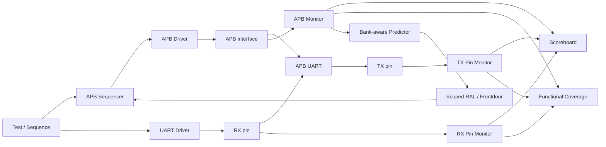

# 验证架构

验证平台使用 SystemVerilog/UVM，通过 APB 事务和独立 UART 引脚解码建立期望值。`rtl/` 与 `rtl_fixed/` 共用顶层接口、Agent、Scoreboard 和测试矩阵；每次编译仅选择一套同名模块。接口约定见 [寄存器说明](registers.md)，两套 RTL 的行为差异见 [修复约定](rtl_fixes.md)。

## 组件与数据流

[`apb_uart_env`](../tb/env/apb_uart_env.sv) 将三个 Monitor 的 analysis port 分别连接到 Scoreboard 与覆盖组件。RAL 专项在测试中额外创建寄存器模型和 predictor；常规环境不依赖 RAL 自动镜像。

- **APB Agent**：驱动器在下降沿设置请求，Monitor 在上升沿观察完成的访问；Setup/Access 稳定性由接口断言检查。DUT 的 PREADY 恒为 1，FIFO 满时仍会完成总线传输。
- **UART Agent**：驱动器向 RX 注入正常帧或错误帧，两个独立 Monitor 分别解码 TX 与 RX。Monitor 确认起始位并在配置位周期的中点采样数据、偶校验和停止位。
- **覆盖组件**：从已完成 APB 访问及实际引脚帧采样，统计寄存器/bank、数据、格式、位周期、错误、复位与中断组合。容量相关 bins 位于 Scoreboard 的外部模型中。

## 独立参考模型

[`apb_uart_scoreboard`](../tb/scoreboard/apb_uart_scoreboard.sv) 不读取 DUT 内部 FIFO、状态机或寄存器层次。串口配置来自已观察到的 LCR/DLL/DLM 写入，位周期采用实现真实行为 `{DLM,DLL}+1`。

| 方向 | 期望值来源 | 实际值来源 | 检查 |
| --- | --- | --- | --- |
| TX | APB Monitor 观察到且外部容量模型接受的 THR 写 | 独立 TX Pin Monitor 解码帧 | 数据、校验与停止位 |
| RX | 独立 RX Pin Monitor 解码完成的帧 | APB Monitor 观察到的 RBR 读返回值 | 数据与接收顺序 |
| 配置 | APB Monitor 观察到的寄存器写及 DLAB bank | APB 读返回值 | 存储值、bank 路由、未实现寄存器零读与高位补零 |

PE/FE 与当前队首字节的关联、中断优先级/确认等状态语义由对应测试显式检查。它们与数据队列比对分别报告，不能仅凭数据一致认定状态行为正确。

### FIFO 容量与时序

TX 模型按时钟推进，分别跟踪 16 个 FIFO 槽位和一个发送移位器，依据配置帧长度、`D+1` 位周期及发送器接受时序预测入队/出队。满 FIFO 的 THR 写被丢弃；同周期出队也不会使旧 full 状态下的写被接受。短突发因此可容纳 17 帧，而非仅由 FIFO 深度决定。

RX 期望队列记录引脚上已完成的帧。FIFO 满时，接收器可在 `SAVE_DATA` 保留第 17 帧，等待 APB 读产生空间；模型允许最多 17 个未读帧，不将其误判为立即丢弃。继续输入造成的持续过载没有通用模型，超出该范围会报告 `MODEL_SCOPE`。

空 RBR 读不比较未定义的低字节，但检查读值高位补零并记录访问。TX 清 FIFO 仅在发送器空闲时使用；活跃发送时清 FIFO 需要额外的在途帧模型，不属于已验证场景。

### 复位

Scoreboard 在异步低有效复位时清空预测队列、配置和容量状态，并递增共享 epoch。UART Monitor 中止复位打断的采样；带旧 epoch 的残帧不会进入新一轮比对。帧中复位测试重新配置 UART 后完成新的双向收发，以检查恢复行为。

## DLAB 感知的 RAL

RAL 只覆盖 IER、LCR、DLL、DLM 四个真实存储 RW 寄存器。`normal_map` 和 `banked_map` 表达地址 0/1 的别名关系；RBR/THR、FCR/IIR、LSR 等副作用或状态寄存器仍由事务检查负责。

IER/DLL/DLM 的自定义 frontdoor 锁住 APB sequencer，读取实际 LCR，按需切换 DLAB，完成目标访问，再恢复完整原 LCR 后解锁。这样一次分页访问的多拍 APB 操作不会被另一个序列交错。LCR 使用普通 adapter 访问。

两个 map 都关闭 auto-prediction。显式 predictor 根据实际完成的 APB 事务跟踪 DLAB、规范化高位地址镜像并选择唯一 map 更新 mirror，避免 RAL 写入通过自预测掩盖总线错误。复位时清理镜像；当前专项只在 RAL 空闲时施加复位，未验证活跃 RAL 操作中断后的取消/重启。实现细节见 [RAL 文档](../tb/ral/README.md)。

## 检查失败与证据

测试通过要求正常退出、明确完成标记、完整 UVM 汇总和零 ERROR/FATAL，并检查请求的 VCD/覆盖数据库实际存在。Scoreboard 在 `check_phase` 检查剩余队列和最低双向比对数，防止无流量的空通过。

四类受控边界故障用于验证指定 checker 的敏感性。它们保留原始 FAIL，并与六次正常控制、上游 RTL 的严格需求失败分别计量。故障激活、错误 ID 和同一二进制校验方法见 [敏感性说明](checker_sensitivity.md)；实测分母和覆盖边界见 [验证结果](validation.md) 与 [覆盖分析](coverage_analysis.md)。
