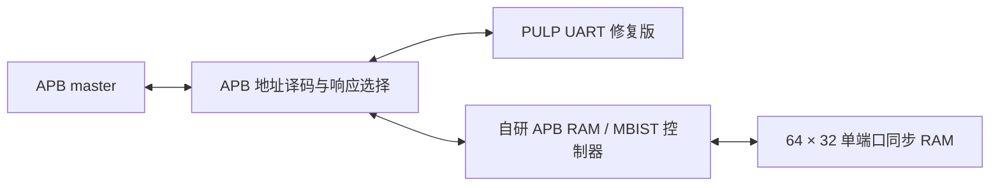

# APB UART / RAM / MBIST 外设子系统

子系统通过一个 APB 接口提供修复版 PULP UART、64 × 32 位单端口同步 RAM 和 RAM 自检寄存器。新增 RTL 负责地址译码、响应选择、RAM 访问权切换和 MBIST。UART 的字节地址及行为沿用原接口。



## 接口规格

| 地址 | 访问 | 行为 |
| --- | --- | --- |
| `0x000–0x007` | UART 字节寄存器 | 保留 UART 原有地址和副作用。 |
| `0x080` | `START`，WO | `bit0=1` 启动自检，清除上次结果。写 `bit0=0` 无操作。忙时重复启动返回 `PSLVERR`。 |
| `0x084` | `STATUS`，RO | `bit0=BUSY`，`bit1=DONE`，`bit2=FAIL`。正常或失败结束均置 `DONE`，只有比较失败置 `FAIL`。 |
| `0x088` | `FAIL_ADDR`，RO | 首次比较失败的 RAM 字索引，范围 `0–63`。 |
| `0x08C` | `EXPECT`，RO | 首次错误的期望 32 位数据。 |
| `0x090` | `ACTUAL`，RO | 首次错误的实测 32 位数据。 |
| `0x094` | `FAIL_STEP`，RO | 首次错误的 March 元素编号，范围 `0–5`。 |
| `0x100–0x1FC` | RAM，RW | 32 位对齐访问。同步读插入一个等待周期，写在访问阶段完成。 |

未映射地址、未对齐 RAM 地址、只读自检寄存器写和 `START` 读均返回 `PSLVERR`。MBIST 独占 RAM 时，RAM 窗口访问立即报错，UART 和自检状态寄存器仍可访问。低有效复位撤销未完成 APB 读并释放自检所有权。RAM 数据阵列无复位初始化，软件在有效读前写入数据。

## 自检算法与设计边界

MBIST 按六个 March C− 元素扫描 64 个地址，数据背景为全零和全一。

| 元素 | 方向 | 每地址操作 |
| --- | --- | --- |
| 0 | 递增 | 写 0 |
| 1 | 递增 | 读 0，写 1 |
| 2 | 递增 | 读 1，写 0 |
| 3 | 递减 | 读 0，写 1 |
| 4 | 递减 | 读 1，写 0 |
| 5 | 递增 | 读 0 |

读请求通过单端口同步 RAM 发出，下一拍比较。无故障时共 640 个 RAM 操作，读比较占用额外 320 拍，自检共 960 拍。失败时保留第一个比较错误并停止。`DONE`、`FAIL` 与诊断值保留到下一次有效启动或复位。

自检会覆盖原有 RAM 内容，复位中止后也可能留下部分测试数据。当前验证范围是 RTL 模型、指定的读数据故障和基本全零／全一数据背景。March 参考包括字组织存储器数据背景与故障模型的差异。[Microchip March C− 说明](https://onlinedocs.microchip.com/oxy/GUID-D1946615-13DB-429F-8835-9FD61AEECC58-en-US-1/GUID-58171B11-CBE8-45BA-9D76-C57C942F4352.html)

## 验证计划

| 验证项 | UVM 用例 | 判定依据 |
| --- | --- | --- |
| 地址与 RAM 数据 | `subsystem_apb_test` | APB monitor、独立数据模型、首末字、等待周期和错误响应。 |
| 无故障自检与并行访问 | `subsystem_mbist_test` | 检查 BUSY/DONE、RAM 独占和 UART 可用性，结束后核对 RAM 内容。 |
| 诊断与恢复 | `subsystem_mbist_fault_test` | 测试环境在索引 63 对读数据施加 bit 3 stuck-at-0，验证 `FAIL_ADDR=63`、元素 2，`FFFFFFFF` 对 `FFFFFFF7`。移除注入后复跑，核对恢复。 |
| 自检期间复位 | `subsystem_mbist_reset_test` | 自检活动时断言复位，检查所有权释放和终态清空，复位后重新写读和启动。 |

故障用例通过的含义是检查器取得预期 MBIST 失败诊断并验证了恢复，仿真仍使用正常 UVM 完成标记。UART 的历史回归、子系统 UVM 和后续门级检查分别记录。

### 实测结果

Verilator 5.054、Accellera UVM 2020.3.1 和 seeds `1/2/3` 下，四个用例共 **12/12 PASS**。独立 APB monitor 完成 3,468 笔事务，其中 1,032 笔成功 RAM 读均等待一拍，60 笔按计划返回 `PSLVERR`。每个运行都比对一帧 TX 和一帧 RX。

VCD 的本地 RAM 端口记录显示 15 次 MBIST 启动，包含 9 次正常完成、3 次预期故障结束和 3 次复位中止。正常运行的六个元素顺序、地址方向及写数据均匹配规格，每次有 640 次本地 RAM 操作。`rtl_subsystem/` 中被该测试平台实际编译的模块命中 198/203 条 LCOV 行（97.54%）。该统计来自子系统覆盖数据库。

故障用例 seed 1 在 5,235 ns 锁存首错。随后 `STATUS` 读回 `0x6`，`FAIL_ADDR` 为 `0x3F`，`EXPECT/ACTUAL` 为 `0xFFFFFFFF/0xFFFFFFF7`，`FAIL_STEP` 为 `2`。这次故障运行在第 319 次本地 RAM 操作后停机。同一个用例关闭注入后再次启动，在 15,165 ns 完成 640 次操作，恢复后 APB 读写继续通过。

在线工作台从已归档的报告、日志和 VCD 生成。打开「计划与回归」，选择「APB 外设子系统 · RAM / MBIST」，再选验证项和 seed。综合、时序和扫描链的证据集中在「实现与 DFT」。[验证计划](https://jiangzheyi1234-star.github.io/apb-uart-uvm/#plan) · [实现与 DFT](https://jiangzheyi1234-star.github.io/apb-uart-uvm/#frontend)

以下命令使用现有 Linux 或 WSL 环境中的 Verilator 和 Accellera UVM。

```bash
python3 py/run_linux_regression.py --suite subsystem --seeds 1 2 3 \
  --coverage --trace --out results/subsystem_acceptance
```

报告保存在指定结果目录，包含每条用例的 `simulation.log`、`waves.vcd`、源文件身份、编译命令及覆盖统计。展开故障用例的 VCD 可沿 `START`、`STATUS`、`FAIL_ADDR`、`EXPECT` 和 `ACTUAL` 的 APB 读写检查诊断。

以下命令将子系统的实测结果合并到本地工作台的验证计划。

```bash
python3 py/build_dashboard.py --subsystem-report results/subsystem_acceptance/report.json \
  --out results/subsystem_workbench
```

打开 `results/subsystem_workbench/index.html#plan`，进入「APB 外设子系统 · RAM / MBIST」。可按验证项跳转到指定测试和 seed 的日志、报告及波形。故障场景的波形默认聚焦第一次 `MBIST fail` 上升沿，并保留完整 VCD。UART 历史统计使用原有分母。

## 综合、时序与扫描链

在 Nangate45 典型角对自研 `apb_ram_mbist` 控制器执行实际标准单元映射和 OpenSTA。综合结果为 **559 个单元、829.388 µm²**，范围限定为控制逻辑及其外部 RAM 端口。Icarus 零延时仿真对 RTL、普通网表、扫描网表逐拍比较了 2,711 个周期。

将 58 个触发器替换成同一库的扫描单元并连接为单链。四种移位向量检查 232 位，另对功能捕获后的诊断寄存器检查 32 位扫描读出。10 ns 约束下 setup 最差余量为 **+4.88060 ns**，hold 最差余量为 **−0.00636 ns**。该检查按布图前典型角和既定 I/O 预算执行，报告记录 hold 违例。[综合、时序与扫描链复现步骤](../flow/frontend/README.md)
