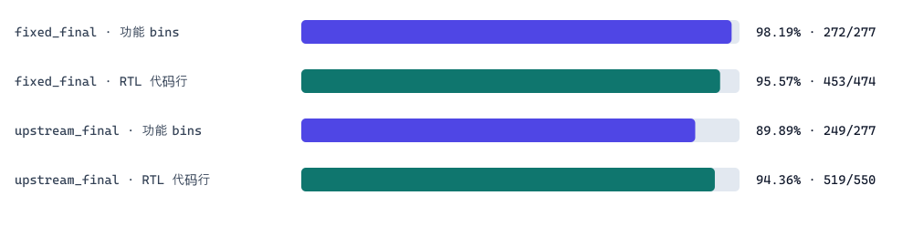
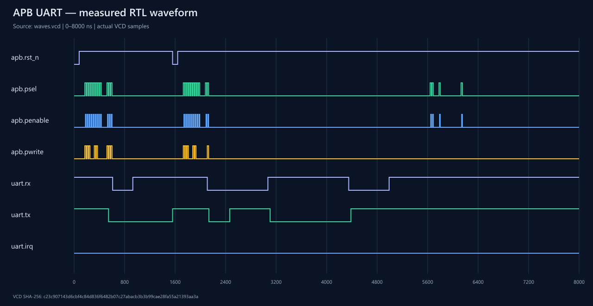

# 最终验证记录

日期：2026-11-23，Asia/Shanghai。实际执行环境：Windows 上的 WSL2 Ubuntu 24.04、GCC 13.3、Verilator 5.054、Accellera UVM 2020.3.1。动态仿真使用真实 RTL 与真实 UVM，不是日志替身。

## 最终验收结果

| 项目 | 修复版 | 未修改上游版 |
| --- | --- | --- |
| 同一套测试矩阵 | 15 场景 × seed 1/2/3 | 15 场景 × seed 1/2/3 |
| 原始运行状态 | 45 PASS，0 FAIL | 33 PASS，12 FAIL |
| 汇总 ERROR/FATAL | 全部 0/0 | 12 个严格需求出现真实 UVM_ERROR，FATAL 为 0 |
| 正常退出与超时 | 全部正常退出，无超时 | 全部正常退出，无超时 |
| PASS 运行 TX/RX 自动比对 | 1,039 / 1,216，合计 2,255 帧 | 1,021 / 955，合计 1,976 帧 |

未修改上游版的 12 个 FAIL 分别为 4 项严格需求 × 3 个 seed：

- `uart_parity_requirement_test`：错误校验没有使 LSR.PE 置位。
- `uart_framing_requirement_test`：低停止位没有使 LSR.FE 置位。
- `uart_error_association_test`：错误状态不能与对应的 FIFO 字节关联。
- `uart_irq_requirement_test`：RX 假中断、无中断编码与确认/撤销行为不满足需求。

这些 FAIL 保留原始日志和状态，未改判为 PASS。其余 33 个原版运行包含缺陷特征检查，通过仅表示行为符合记录。修复版对同样的严格需求全部通过。

最终证据目录：[可打开的 HTML 报告](evidence/index.html)、[机器可读汇总](evidence/summary.json)、[输入 SHA-256 清单](evidence/inputs.json)、[验收 JSON](evidence/acceptance.json)。

## 覆盖率

| 修复版指标 | 实测值 |
| --- | ---: |
| 功能 bins 未加权命中率 | 272/277，98.19% |
| 普通帧格式交叉 | 32/32，100% |
| 方向 × 位宽 × 校验 × 停止位 × 波特周期 | 96/96，100% |
| RTL LCOV 行命中率 | 453/474，95.57% |
| RTL LCOV 分支命中率 | 1,670/2,120，78.77% |

功能统计直接读取合并后的原生 `coverage.dat`，按 bin 的 at_least 阈值计算，未加权。原始 covergroup 中两个 default bin 按工具规则不参与覆盖率；没有在补测后修改覆盖组或新增排除项。它不等同于加权的 SystemVerilog covergroup API 百分比。RTL 行/分支数据来自 Verilator 导出的 LCOV，单独统计 RTL 文件，未把 UVM 库代码混入设计分母。

图中原版覆盖只合并 33 个 PASS 运行，12 个严格需求失败不贡献合并覆盖；两套 RTL 的代码行分母不同，因此不把两条代码覆盖百分比的差值解释为质量提升。

[覆盖缺口分析](coverage_analysis.md) 记录从 248/277 到 272/277 的定向补测与剩余 5 个诊断 bin。代码覆盖率未宣称 100%。



## 复位与引脚证据

下图由实际最终 VCD 的标量采样生成，保留原始 VCD SHA-256；不是手绘的预期波形。约 1.6 微秒处可以看到在 TX/RX 活动期间复位，以及之后恢复新帧。



[正常双向帧波形](evidence/smoke_waveform.svg)。可分享证据还包含原版/修复版各 3 个选定 VCD、两个真实合并覆盖数据库、LCOV、全部 90 次原始日志与编译时源码快照。

## 自动验收与工具检查

`py/validate_acceptance.py` 对两份最终报告执行 **100 项检查，全部通过**，包含：

- 恰好 15 场景 × 3 seed，两套环境使用相同 TB 文件和 UVM 源码。
- PASS 完成标记、完整 UVM 汇总、真实双向比对数、正常退出及文件存在性。
- 12 个原版严格需求确实因功能 UVM_ERROR 失败，而非超时、崩溃或构建错误。
- 3 个压力测试 seed 产生不同的数据/格式摘要；相同 seed 在两套 RTL 重放相同刺激。
- 从原生数据库重新计数 bins，从 LCOV 重新统计 RTL 行，核对所有 45 个 PASS 数据库都参与合并。
- 编译前源码快照与当前 SV 源码一致，8 个上游文件 Git blob 保持原样。

另外，**32 项 Python 工具测试通过**，覆盖日志假成功、超时、失败进程、一次编译多运行、缺少模拟器、命令预演、覆盖报告解析及安全解包等。进程替身仅用于 Python 工具测试；上面的 90 次 UART 结果来自真实 Verilator 仿真。

静态检查使用 pyslang 12.2.0：两套 RTL + UVM 1.2 全环境为 0 errors、2 条上游 UVM 空循环警告；UVM 2020.3.1 全环境为 0 errors、1 条上游转义字符警告。商业 Questa/VCS 入口尚未实际执行。

实际 UVM 运行每次有两条库自身的提示警告：UVM_NO_DPI 支持提示及禁用 DPI 后不检查组件名称约束。未屏蔽功能检查错误。Verilator 编译日志保留标准 UVM 字段宏的位宽诊断，原始 RTL 的设计诊断也保留。

## 复跑

从项目目录执行：

```bash
bash scripts/run_full_regression.sh --out results/new_fixed
RTL_VARIANT=upstream bash scripts/run_full_regression.sh --out results/new_upstream
python3 py/validate_acceptance.py --fixed results/new_fixed/report.json \
  --upstream results/new_upstream/report.json --out results/new_acceptance.json
```

原版回归命令应返回失败退出码，以保留真实缺陷状态；验收工具会独立检查失败集合是否恰好符合要求。工具不会把任意失败当作已知缺陷。

每次用新的输出目录。原始 `results/` 和工具缓存不纳入源代码 ZIP，精选证据在 `docs/evidence/` 内可离线查看。数据库和波形有对应原文件 SHA-256，源码 ZIP 内另附逐文件校验清单。

