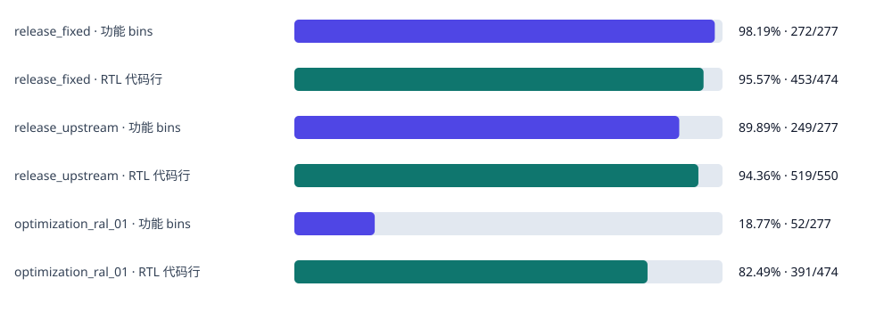
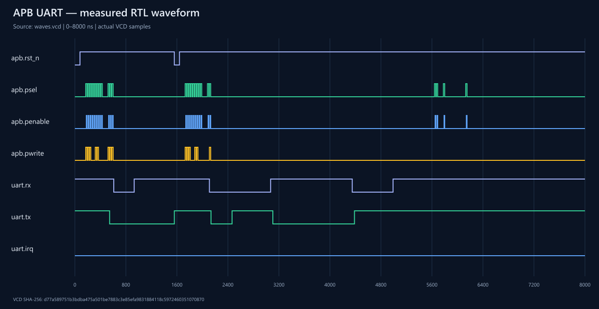

# 最终验证记录

日期：2026-11-23，Asia/Shanghai。本地实际执行环境：Windows 上的 WSL2 Ubuntu 24.04、GCC 13.3、Verilator 5.054、Accellera UVM 2020.3.1。动态仿真使用真实 RTL 与真实 UVM。GitHub 托管 Ubuntu 24.04 也已完成下文列出的默认 CI。

## 最终验收结果

| 项目 | 修复版 | 未修改上游版 |
| --- | --- | --- |
| 同一套测试矩阵 | 15 场景 × seed 1/2/3 | 15 场景 × seed 1/2/3 |
| 原始运行状态 | 45 PASS，0 FAIL | 33 PASS，12 FAIL |
| 汇总 ERROR/FATAL | 全部 0/0 | 12 个严格需求出现真实 UVM_ERROR，FATAL 为 0 |
| 正常退出与超时 | 全部正常退出，无超时 | 全部正常退出，无超时 |
| PASS 运行 TX/RX 自动比对 | 1,039 / 1,216，合计 2,255 帧 | 1,021 / 955，合计 1,976 帧 |

未修改上游版的 12 个 FAIL 分别为 4 项严格需求 × 3 个 seed：

- `uart_parity_requirement_test`：错误校验没有使 LSR.PE 置位。
- `uart_framing_requirement_test`：低停止位没有使 LSR.FE 置位。
- `uart_error_association_test`：错误状态不能与对应的 FIFO 字节关联。
- `uart_irq_requirement_test`：RX 假中断、无中断编码与确认/撤销行为不满足需求。

这些 FAIL 保留原始日志和状态，未改判为 PASS。其余 33 个原版运行包含缺陷特征检查，通过仅表示行为符合记录。修复版对同样的严格需求全部通过。

最新发布证据：[93 次回归的 HTML 报告](release/index.html)、[机器可读汇总](release/summary.json)、[输入 SHA-256 清单](release/inputs.json)。其范围是核心双版本 90 次运行加独立 RAL 3 次运行，原始状态合计为 81 PASS、12 FAIL。

最新核心矩阵的 [100 项验收 JSON](release/acceptance.json) 全部通过，本地原件为 `results/release_acceptance.json`。`docs/evidence/` 保留为历史基线：[历史 HTML](evidence/index.html)、[历史验收 JSON](evidence/acceptance.json)。复跑工具与命令见后文。

## 新增 RAL 与检查器敏感性证据

独立的 `uart_ral_test` 在 seed 1、2、3 实际 **3/3 PASS**，每次验证 IER、LCR、DLL、DLM 四个配置寄存器，记录 12 轮随机配置、56 次 RAL 写和 97 次镜像读，三次合计 **168 次写、291 次镜像读**。普通/分页预测、复位和 bank frontdoor 并发访问均有运行日志。

| 修复版统计范围 | 运行结果 | PASS 运行 TX / RX 比对 | 合计帧数 |
| --- | --- | ---: | ---: |
| 核心 15 场景 × 3 seed | 45/45 PASS | 1,039 / 1,216 | 2,255 |
| 新增 RAL × 3 seed | 3/3 PASS | 3 / 3 | 6 |
| 核心与独立 RAL 合计 | 48/48 PASS | 1,042 / 1,219 | 2,261 |

另行执行的检查器敏感性实验为 **4/4 指定故障检出、6/6 注入前后无故障控制通过**。四种边界故障对应的唯一错误 ID 分别为 `TX_MISMATCH`、`RX_MISMATCH`、`STATUS`、`IRQ`。故障运行保留原始 `FAIL`，另用 `DETECTED` 标记检出；它们不是新增发现的四个 DUT 缺陷，也不是对全部可能故障的穷举。48 次统计范围限定为上表的核心与 RAL，敏感性实验单独计量。

[RAL 与敏感性实验 HTML](features/index.html)、[功能证据汇总](features/summary.json)、[功能证据 SHA-256 清单](features/inputs.json) 包含 17 份仿真日志及同一记录二进制、编译源码快照和暂存映射的交叉核验；方法与边界见 [检查器敏感性说明](checker_sensitivity.md)。

## 覆盖率

| 修复版指标 | 实测值 |
| --- | ---: |
| 功能 bins 未加权命中率 | 272/277，98.19% |
| 普通帧格式交叉 | 32/32，100% |
| 方向 × 位宽 × 校验 × 停止位 × 波特周期 | 96/96，100% |
| RTL LCOV 行命中率 | 453/474，95.57% |
| RTL LCOV 分支命中率 | 1,670/2,120，78.77% |

功能统计直接读取合并后的原生 `coverage.dat`，按 bin 的 at_least 阈值计算，未加权。原始 covergroup 中两个 default bin 按工具规则不参与覆盖率；没有在补测后修改覆盖组或新增排除项。它不等同于加权的 SystemVerilog covergroup API 百分比。RTL 行/分支数据来自 Verilator 导出的 LCOV，单独统计 RTL 文件，未把 UVM 库代码混入设计分母。

图中原版覆盖只合并 33 个 PASS 运行，12 个严格需求失败不贡献合并覆盖。独立 RAL 报告的覆盖率按其 3 次运行单独展示，没有与核心 45 次回归合并；上表的 272/277 仍指核心修复版。两套 RTL 的代码行分母不同，因此不把两条代码覆盖百分比的差值解释为质量提升。

[覆盖缺口分析](coverage_analysis.md) 记录从 248/277 到 272/277 的定向补测与剩余 5 个诊断 bin。代码覆盖率未宣称 100%。



## 复位与引脚证据

最新 [发布报告](release/index.html) 提供原版/修复版的复位、错误帧、中断场景各一个 seed 1 代表性 VCD，共 6 份，保留对应文件 SHA-256。发布目录还打包 93 份原始仿真日志、3 个真实合并覆盖数据库与 LCOV、编译时源码快照和暂存字节一致性映射，可沿报告中的相对链接独立复核。



[正常收发波形](release/smoke_waveform.svg) 与上图均从当前实际 VCD 采样生成，图内保留原文件 SHA-256。

## 自动验收与工具检查

`py/validate_acceptance.py` 对两份最终报告执行 **100 项检查，全部通过**，包含：

- 恰好 15 场景 × 3 seed，两套环境使用相同 TB 文件和 UVM 源码。
- PASS 完成标记、完整 UVM 汇总、真实双向比对数、正常退出及文件存在性。
- 12 个原版严格需求确实因功能 UVM_ERROR 失败，而非超时、崩溃或构建错误。
- 3 个压力测试 seed 产生不同的数据/格式摘要；相同 seed 在两套 RTL 重放相同刺激。
- 从原生数据库重新计数 bins，从 LCOV 重新统计 RTL 行，核对所有 45 个 PASS 数据库都参与合并。
- 编译前源码快照与当前 SV 源码一致，8 个上游文件 Git blob 保持原样。

另外，**40 项 Python 工具测试通过**，覆盖日志假成功、超时、失败进程、一次编译多运行、缺少模拟器、命令预演、覆盖报告解析、安全解包，以及 mutation 激活、预期错误 ID、混入无关错误、前后控制和二进制身份校验。进程替身仅用于 Python 工具测试；本页的核心、RAL 与敏感性结果来自真实 Verilator 仿真。

静态检查使用 pyslang 12.2.0：两套 RTL + UVM 1.2 全环境为 0 errors、2 条上游 UVM 空循环警告；UVM 2020.3.1 全环境为 0 errors、1 条上游转义字符警告。商业 Questa/VCS 入口尚未实际执行。

实际运行保留两条库提示：UVM_NO_DPI 支持提示及禁用 DPI 后不检查组件名称约束。RAL 专项另保留三条 `[RegModel]` 初始化警告：在 `lock_model()` 前安装 frontdoor 时查询尚未初始化的 map；随后锁定模型且读写/预测检查全部通过。未宣称零警告，也未屏蔽这些记录。Verilator 编译日志保留标准 UVM 字段宏的位宽诊断，原始 RTL 的设计诊断也保留。

## 已执行的 GitHub CI 与范围

[GitHub Actions 运行 45206296552](https://github.com/jiangzheyi1234-star/apb-uart-uvm/actions/runs/45206296552) 的两个 job 均已真实 `success`：Python 工具/上游字节校验，以及实际 UVM 仿真。默认仿真 job 执行修复版核心 45 次、独立 RAL 3 次及敏感性实验 10 次（6 次干净控制、4 次原始 FAIL 的指定故障检出），并上传原始报告、日志与覆盖率证据。

该次默认运行的“上游缺陷基线与双 45 次矩阵验收”步骤为 `skipped`。上游结果及 100 项验收已经在本地通过独立核验；包含该步骤的下一轮 `full_regression=true` 手动 dispatch 尚待验证，不计入已完成的远端 CI 成绩。

## 复跑

从项目目录执行：

```bash
bash scripts/run_full_regression.sh --out results/new_fixed
RTL_VARIANT=upstream bash scripts/run_full_regression.sh --out results/new_upstream
python3 py/validate_acceptance.py --fixed results/new_fixed/report.json \
  --upstream results/new_upstream/report.json --out results/new_acceptance.json
python3 py/run_linux_regression.py --rtl fixed --test uart_ral_test \
  --seeds 1 2 3 --coverage --trace --out results/new_ral
```

原版回归命令应返回失败退出码，以保留真实缺陷状态；验收工具会独立检查失败集合是否恰好符合要求。工具不会把任意失败当作已知缺陷。

每次用新的输出目录。敏感性实验需使用仍与编译二进制哈希匹配的实际 PASS 基线，运行方式见 [敏感性说明](checker_sensitivity.md)。原始 `results/` 和工具缓存不纳入源代码 ZIP；最新精选证据在 `docs/release/` 与 `docs/features/` 离线查看，`docs/evidence/` 用于历史回溯。数据库、波形和日志均有对应原文件 SHA-256，源码 ZIP 内另附逐文件校验清单。

